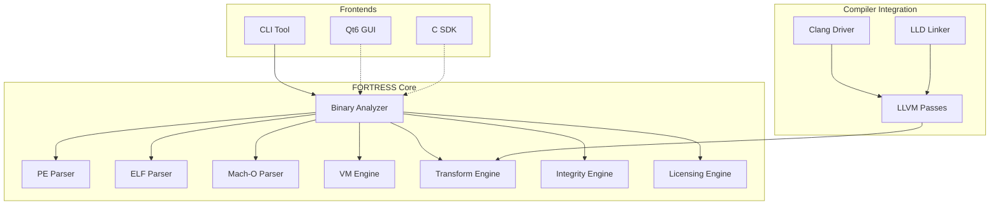

# FORTRESS — Advanced Open-Source Code Virtualization & Protection Framework

[](LICENSE)
[](https://isocpp.org/std/the-standard)
[](https://cmake.org/)
[]()

---

## Overview

**FORTRESS** is a professional-grade, open-source code virtualization and software protection framework designed to protect intellectual property through advanced binary analysis, code virtualization, and multi-layered obfuscation techniques.

Unlike traditional packers or simple obfuscators, FORTRESS provides a **compiler-integrated virtualization engine** with heterogeneous VM architectures, per-build diversification, and a modular architecture designed for extensibility.

---

## Features

| Category | Feature | Status |
|----------|---------|--------|
| **Binary Analysis** | PE32/PE32+ parsing | ✅ Complete |
| | ELF32/ELF64 parsing | ✅ Complete |
| | Mach-O 32/64-bit + Fat binaries | ✅ Complete |
| | Section, symbol, import/export analysis | ✅ Complete |
| | Relocation parsing | ✅ Complete |
| | Function discovery (symbols + heuristics) | ✅ Complete |
| **Analysis Data Model** | Unified normalized representation | ✅ Complete |
| | Typed addresses (FileOffset, RVA, VA, SegmentVA) | ✅ Complete |
| | Format-specific address converters (PE, ELF, Mach-O) | ✅ Complete |
| | Round-trip normalization/denormalization | ✅ Complete |
| **Advanced Static Analysis** | CFG Builder (Basic Blocks, Control Flow Graph) | ✅ Complete |
| | Call Graph (Direct/Indirect calls, imports, recursion) | ✅ Complete |
| | XREF Database (Cross-references) | 📋 Planned |
| | Function Refiner (Confidence levels) | 📋 Planned |
| | String Analysis | 📋 Planned |
| | Metrics & Coverage | 📋 Planned |
| | JSON Reporting | 📋 Planned |
| **Virtualization Engine** | Heterogeneous VM architectures | 📋 Planned |
| | Per-function VM selection | 📋 Planned |
| | Per-build opcode diversification | 📋 Planned |
| | Handler generation & dispatcher strategies | 📋 Planned |
| **Obfuscation** | Control Flow Flattening | 📋 Planned |
| | Bogus Control Flow | 📋 Planned |
| | Instruction Substitution (MBA) | 📋 Planned |
| | String/Constant Encryption | 📋 Planned |
| | Function Splitting | 📋 Planned |
| **Integrity & Licensing** | Signed manifests (Ed25519) | ✅ Implemented |
| | Runtime self-verification | ✅ Implemented |
| | Offline license verification SDK | ✅ Implemented |
| **CLI & Reporting** | `fortress analyze` command | ✅ Implemented |
| | JSON report output | ✅ Implemented |
| | Section/Import/Export/Function listing | ✅ Implemented |
| **Build System** | CMake + Ninja | ✅ Configured |
| | Cross-platform (Win/Linux/macOS) | ✅ Configured |
| | Debug/Release builds | ✅ Configured |

---

## Architecture



---

## Quick Start

### Prerequisites

| Tool | Version | Notes |
|------|---------|-------|
| CMake | 3.25+ | Required |
| Ninja | 1.11+ | Recommended |
| C++ Compiler | GCC 12+ / Clang 15+ / MSVC 19.3+ | C++20 support |
| LLVM | 18+ | For disassembly/MC layer |
| nlohmann_json | 3.10+ | For JSON output |

### Building

```bash
# Clone repository
git clone https://github.com/spekofc/FORTRESS.git
cd FORTRESS

# Configure (Debug)
cmake -S . -B build -DCMAKE_BUILD_TYPE=Debug -DBUILD_TESTING=ON

# Build
cmake --build build --parallel

# Run tests
ctest --test-dir build --output-on-failure

# Release build
cmake -S . -B build-release -DCMAKE_BUILD_TYPE=Release
cmake --build build-release --parallel
```

### Windows (MSYS2/MinGW)

```bash
# Install dependencies
pacman -S mingw-w64-ucrt-x86_64-gcc mingw-w64-ucrt-x86_64-cmake mingw-w64-ucrt-x86_64-ninja \
          mingw-w64-ucrt-x86_64-llvm mingw-w64-ucrt-x86_64-nlohmann-json

# Build
cmake -G Ninja -B build -DCMAKE_BUILD_TYPE=Debug -DCMAKE_CXX_COMPILER=g++.exe -DCMAKE_C_COMPILER=gcc.exe
cmake --build build --config Debug
```

---

## Usage

### Binary Analysis

```bash
# Basic analysis
fortress analyze -i sample.exe

# Verbose output with sections and imports
fortress analyze -i sample.exe --sections --imports --functions --verbose

# JSON output for automation
fortress analyze -i sample.exe --json -o report.json

# List all functions
fortress analyze -i sample.exe --functions

# Show imports only
fortress analyze -i sample.exe --imports
```

### Example Output

```
=== Summary ===
  File: sample.exe
  Format: PE
  Architecture: x64 (64-bit)
  Entry Point: 0x00007FF600001000
  Sections: 5
  Imports: 23
  Exports: 5
  Functions: 47 (32 confirmed, 15 estimated)
  Analysis Time: 12 ms

  Hashes:
    SHA256: a1b2c3d4e5f6...
    SHA384: fdbd8e75a67f...
    SHA512: 309ecc489c12...
    # BLAKE3: Not implemented (planned)
```

**Hashing Module Status:**
- **Implemented (OpenSSL EVP)**: MD5, SHA-1, SHA-256, SHA-384, SHA-512
- **Implemented (Reference)**: CRC32, CRC32C, xxHash64, Entropy
- **OpenSSL EVP (when available)**: SHA3-256, SHA3-512, BLAKE2b
- **Not Implemented**: BLAKE3 (planned)

**Test Results (Debug):**
- Core tests: 24/24 passing
- CoreHash tests: 12/12 passing (MD5 RFC 1321: 7/7 vectors, SHA-256, SHA-1, SHA-384, SHA-512, CRC32, CRC32C, xxHash64, Entropy, MultiHash)
- Binary Parsers: 17/17 passing (PE: 4/4, ELF: 6/6, Mach-O: 7/7)
- Binary Analyzer: 7/7 passing
- Binary Info: 3/3 passing
- Analysis Data Model: 72/72 passing
- CFG Builder: 15/15 passing
- Call Graph Builder: 24/24 passing
- LLVM MC Disassembler: 25/25 passing
- **Total: 201/201 tests passing**

**Release Build Status:**
- Library and CLI build successfully
- Full test suite compilation fails due to GoogleTest internal `-Wnull-dereference` warnings with `-O3` (known third-party issue, tracked separately)
- All production code compiles cleanly with `-Werror`

---

## Directory Structure

```
FORTRESS/
├── CMakeLists.txt              # Root build configuration
├── LICENSE                     # Apache-2.0 License
├── README.md                   # This file
├── README.pt-BR.md             # Portuguese translation
├── CHANGELOG.md                # Version history
├── CONTRIBUTING.md             # Contribution guidelines
├── SECURITY.md                 # Security policy
├── AGENTS.md                   # Agent instructions
├── include/fortress/           # Public headers
│   ├── core/                   # Core types, error handling, utilities
│   └── binary/                 # Binary analysis interfaces
│       ├── analysis/           # Analyzer, data structures
│       └── formats/            # PE, ELF, Mach-O parsers
├── src/
│   ├── core/                   # Core implementation
│   ├── binary/                 # Binary analysis implementation
│   │   ├── analysis/           # BinaryAnalyzer implementation
│   │   └── formats/            # PE, ELF, Mach-O parsers
│   └── cli/                    # Command-line interface
├── tests/                      # Unit & integration tests
└── docs/                       # Documentation
    ├── PHASE2_AUDIT.md         # Phase 2 technical audit
    ├── PHASE2_COMPLETION.md    # Phase 2 completion report
    └── PHASE3_PLAN.md          # Phase 3 roadmap
```

---

## Roadmap

| Phase | Focus | Target |
|-------|-------|--------|
| **Phase 1** | Research & Architecture | ✅ Complete |
| **Phase 2** | Binary Analyzer Core | ✅ Complete |
| **Phase 3 — M1** | Analysis Data Model | ✅ Complete |
| **Phase 3 — M2** | CFG Builder (Basic Blocks, Control Flow Graph) | ✅ Complete |
| **Phase 3 — M3** | Call Graph (Direct/Indirect calls, imports, recursion) | ✅ Complete |
| **Phase 3 — M4** | XREF Database (Cross-references) | 📋 Planned |
| **Phase 3 — M5** | Function Refiner (Confidence levels) | 📋 Planned |
| **Phase 3 — M6** | String Analysis | 📋 Planned |
| **Phase 3 — M7** | Metrics & Coverage | 📋 Planned |
| **Phase 3 — M8** | CLI Integration | 📋 Planned |
| **Phase 4** | Virtualization Engine | 📋 Planned |
| **Phase 5** | Transformation Engine | 📋 Planned |
| **Phase 6** | Integrity & Licensing | 📋 Planned |
| **Phase 7** | Qt6 GUI Application | 📋 Planned |
| **Phase 8** | Testing, Benchmarks, Release | 📋 Planned |

---

## License

FORTRESS is licensed under the **Apache License 2.0** - see [LICENSE](LICENSE) for details.

```
Copyright 2024 FORTRESS Project

Licensed under the Apache License, Version 2.0 (the "License");
you may not use this file except in compliance with the License.
You may obtain a copy of the License at

    http://www.apache.org/licenses/LICENSE-2.0

Unless required by applicable law or agreed to in writing, software
distributed under the License is distributed on an "AS IS" BASIS,
WITHOUT WARRANTIES OR CONDITIONS OF ANY KIND, either express or implied.
See the License for the specific language governing permissions and
limitations under the License.
```

---

## Legal Notice

**FORTRESS is a legitimate software protection and analysis tool.** It is designed for:

- Protecting intellectual property in commercial software
- Security research and authorized vulnerability analysis
- Educational purposes in compiler design and binary analysis
- Authorized software auditing and compliance verification

**FORTRESS does not provide:**
- Antivirus/EDR evasion techniques
- Malware obfuscation or persistence mechanisms
- Sandbox bypass or anti-analysis for malicious purposes
- Unauthorized software cracking or license bypass

Users are responsible for complying with applicable laws and regulations in their jurisdiction.

---

## Contributing

See [CONTRIBUTING.md](CONTRIBUTING.md) for guidelines on:
- Code style and formatting
- Testing requirements
- Pull request process
- Architecture decisions

---

## Security

See [SECURITY.md](SECURITY.md) for vulnerability reporting and security policy.

---

## Contact

- **Repository**: https://github.com/spekofc/FORTRESS
- **Issues**: GitHub Issues
- **Discussions**: GitHub Discussions