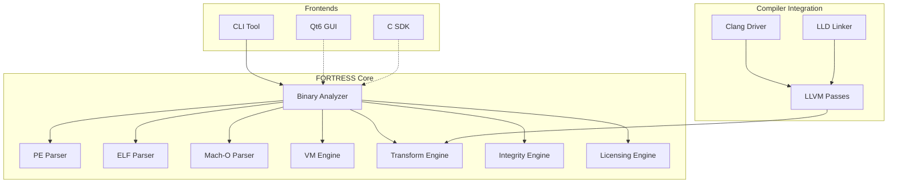

# FORTRESS — Framework Avançado de Virtualização e Proteção de Código Open-Source

[](LICENSE)
[](https://isocpp.org/std/the-standard)
[](https://cmake.org/)
[]()

---

## Visão Geral

**FORTRESS** é um framework profissional, open-source, de virtualização de código e proteção de software, projetado para proteger propriedade intelectual através de análise binária avançada, virtualização de código e técnicas de ofuscação em múltiplas camadas.

Diferente de packers tradicionais ou ofuscadores simples, o FORTRESS fornece um **motor de virtualização integrado ao compilador** com arquiteturas VM heterogêneas, diversificação por build e arquitetura modular projetada para extensibilidade.

---

## Funcionalidades

| Categoria | Funcionalidade | Status |
|-----------|----------------|--------|
| **Análise Binária** | Parsing PE32/PE32+ | ✅ Completo |
| | Parsing ELF32/ELF64 | ✅ Completo |
| | Parsing Mach-O 32/64-bit + Fat binaries | ✅ Completo |
| | Análise de seções, símbolos, imports/exports | ✅ Completo |
| | Parsing de relocações | ✅ Completo |
| | Descoberta de funções (símbolos + heurísticas) | ✅ Completo |
| **Modelo de Dados de Análise** | Representação normalizada unificada | ✅ Completo |
| | Endereços tipados (FileOffset, RVA, VA, SegmentVA) | ✅ Completo |
| | Conversores de endereço específicos (PE, ELF, Mach-O) | ✅ Completo |
| | Normalização/desnormalização round-trip | ✅ Completo |
| **Motor de Virtualização** | Arquiteturas VM heterogêneas | 📋 Planejado |
| | Seleção de VM por função | 📋 Planejado |
| | Diversificação de opcodes por build | 📋 Planejado |
| | Geração de handlers e estratégias de dispatch | 📋 Planejado |
| **Ofuscação** | Control Flow Flattening | 📋 Planejado |
| | Bogus Control Flow | 📋 Planejado |
| | Substituição de Instruções (MBA) | 📋 Planejado |
| | Criptografia de Strings/Constantes | 📋 Planejado |
| | Function Splitting | 📋 Planejado |
| **Integridade e Licenciamento** | Manifestos assinados (Ed25519) | ✅ Implementado |
| | Auto-verificação em runtime | ✅ Implementado |
| | SDK de verificação de licença offline | ✅ Implementado |
| **CLI e Relatórios** | Comando `fortress analyze` | ✅ Implementado |
| | Saída JSON | ✅ Implementado |
| | Listagem de seções/imports/exports/funções | ✅ Implementado |
| **Sistema de Build** | CMake + Ninja | ✅ Configurado |
| | Multiplataforma (Win/Linux/macOS) | ✅ Configurado |
| | Builds Debug/Release | ✅ Configurado |

---

## Arquitetura



---

## Início Rápido

### Pré-requisitos

| Ferramenta | Versão | Notas |
|------------|--------|-------|
| CMake | 3.25+ | Obrigatório |
| Ninja | 1.11+ | Recomendado |
| Compilador C++ | GCC 12+ / Clang 15+ / MSVC 19.3+ | Suporte C++20 |
| LLVM | 18+ | Para desassembly/MC layer |
| nlohmann_json | 3.10+ | Para saída JSON |

### Compilação

```bash
# Clonar repositório
git clone https://github.com/spekofc/FORTRESS.git
cd FORTRESS

# Configurar (Debug)
cmake -S . -B build -DCMAKE_BUILD_TYPE=Debug -DBUILD_TESTING=ON

# Compilar
cmake --build build --parallel

# Executar testes
ctest --test-dir build --output-on-failure

# Build Release
cmake -S . -B build-release -DCMAKE_BUILD_TYPE=Release
cmake --build build-release --parallel
```

### Windows (MSYS2/MinGW)

```bash
# Instalar dependências
pacman -S mingw-w64-ucrt-x86_64-gcc mingw-w64-ucrt-x86_64-cmake mingw-w64-ucrt-x86_64-ninja \
          mingw-w64-ucrt-x86_64-llvm mingw-w64-ucrt-x86_64-nlohmann-json

# Compilar
cmake -G Ninja -B build -DCMAKE_BUILD_TYPE=Debug -DCMAKE_CXX_COMPILER=g++.exe -DCMAKE_C_COMPILER=gcc.exe
cmake --build build --config Debug
```

---

## Uso

### Análise Binária

```bash
# Análise básica
fortress analyze -i exemplo.exe

# Saída verbosa com seções e imports
fortress analyze -i exemplo.exe --sections --imports --functions --verbose

# Saída JSON para automação
fortress analyze -i exemplo.exe --json -o relatorio.json

# Listar todas as funções
fortress analyze -i exemplo.exe --functions

# Mostrar apenas imports
fortress analyze -i exemplo.exe --imports
```

### Exemplo de Saída

```
=== Resumo ===
  Arquivo: exemplo.exe
  Formato: PE
  Arquitetura: x64 (64-bit)
  Entry Point: 0x00007FF600001000
  Seções: 5
  Imports: 23
  Exports: 5
  Funções: 47 (32 confirmadas, 15 estimadas)
  Tempo de Análise: 12 ms

  Hashes:
    SHA256: a1b2c3d4e5f6...
    SHA384: fdbd8e75a67f...
    SHA512: 309ecc489c12...
```

**Status do Módulo de Hashing:**
- **Implementado (OpenSSL EVP)**: MD5, SHA-1, SHA-256, SHA-384, SHA-512
- **Implementado (Referência)**: CRC32, CRC32C, xxHash64, Entropia
- **OpenSSL EVP (quando disponível)**: SHA3-256, SHA3-512, BLAKE2b
- **Não Implementado**: BLAKE3 (planejado)

**Resultados dos Testes (Debug):**
- Testes Core: 24/24 passando
- Testes CoreHash: 12/12 passando (MD5 RFC 1321: 7/7 vetores, SHA-256, SHA-1, SHA-384, SHA-512, CRC32, CRC32C, xxHash64, Entropia, MultiHash)
- Parsers Binários: 17/17 passando (PE: 4/4, ELF: 6/6, Mach-O: 7/7)
- Binary Analyzer: 7/7 passando
- Binary Info: 3/3 passando
- Analysis Data Model: 72/72 passando
- CFG Builder: 15/15 passando
- Call Graph Builder: 24/24 passando
- LLVM MC Disassembler: 25/25 passando
- **Total: 187/187 testes passando**

**Status do Build Release:**
- Biblioteca e CLI compilam com sucesso
- Compilação da suíte completa de testes falha devido a warnings `-Wnull-dereference` internos do GoogleTest com `-O3` (problema conhecido de terceiro, rastreado separadamente)
- Todo código de produção compila limpo com `-Werror`

---

## Estrutura de Diretórios

```
FORTRESS/
├── CMakeLists.txt              # Configuração de build raiz
├── LICENSE                     # Licença Apache-2.0
├── README.md                   # Este arquivo (inglês)
├── README.pt-BR.md             # Esta tradução
├── CHANGELOG.md                # Histórico de versões
├── CONTRIBUTING.md             # Diretrizes de contribuição
├── SECURITY.md                 # Política de segurança
├── AGENTS.md                   # Instruções para agentes
├── include/fortress/           # Headers públicos
│   ├── core/                   # Tipos core, error handling, utilitários
│   └── binary/                 # Interfaces de análise binária
│       ├── analysis/           # Analyzer, estruturas de dados
│       └── formats/            # Parsers PE, ELF, Mach-O
├── src/
│   ├── core/                   # Implementação core
│   ├── binary/                 # Implementação análise binária
│   │   ├── analysis/           # Implementação BinaryAnalyzer
│   │   └── formats/            # Parsers PE, ELF, Mach-O
│   └── cli/                    # Interface de linha de comando
├── tests/                      # Testes unitários e integração
└── docs/                       # Documentação
    ├── PHASE2_AUDIT.md         # Auditoria técnica Fase 2
    ├── PHASE2_COMPLETION.md    # Relatório de conclusão Fase 2
    └── PHASE3_PLAN.md          # Roadmap Fase 3
```

---

## Roadmap

| Fase | Foco | Status |
|------|------|--------|
| **Fase 1** | Pesquisa e Arquitetura | ✅ Completa |
| **Fase 2** | Binary Analyzer Core | ✅ Completa |
| **Fase 3 — M1** | Analysis Data Model | ✅ Completa |
| **Fase 3 — M2** | CFG Builder (Basic Blocks, Control Flow Graph) | ✅ Completa |
| **Fase 3 — M3** | Call Graph (Direct/Indirect calls, imports, recursion) | ✅ Completa |
| **Fase 3 — M4** | XREF Database (Cross-references) | 📋 Planejado |
| **Fase 3 — M5** | Function Refiner (Confidence levels) | 📋 Planejado |
| **Fase 3 — M6** | String Analysis | 📋 Planejado |
| **Fase 3 — M7** | Metrics & Coverage | 📋 Planejado |
| **Fase 3 — M8** | CLI Integration | 📋 Planejado |
| **Fase 4** | Motor de Virtualização | 📋 Planejado |
| **Fase 5** | Motor de Transformação | 📋 Planejado |
| **Fase 6** | Integridade e Licenciamento | 📋 Planejado |
| **Fase 7** | Interface Gráfica Qt6 | 📋 Planejado |
| **Fase 8** | Testes, Benchmarks, Release | 📋 Planejado |

---

## Licença

O FORTRESS é licenciado sob a **Apache License 2.0** - veja [LICENSE](LICENSE) para detalhes.

```
Copyright 2024 FORTRESS Project

Licensed under the Apache License, Version 2.0 (the "License");
you may not use this file except in compliance with the License.
You may obtain a copy of the License at

    http://www.apache.org/licenses/LICENSE-2.0

Unless required by applicable law or agreed to in writing, software
distributed under the License is distributed on an "AS IS" BASIS,
WITHOUT WARRANTIES OR CONDITIONS OF ANY KIND, either express or implied.
See the License for the specific language governing permissions and
limitations under the License.
```

---

## Aviso Legal

**O FORTRESS é uma ferramenta legítima de proteção e análise de software.** Ele é projetado para:

- Proteger propriedade intelectual em software comercial
- Pesquisa de segurança e análise de vulnerabilidades autorizada
- Fins educacionais em design de compiladores e análise binária
- Auditoria de software autorizada e verificação de conformidade

**O FORTRESS NÃO fornece:**
- Técnicas de evasão de antivírus/EDR
- Ofuscação de malware ou mecanismos de persistência
- Bypass de sandbox ou anti-análise para propósitos maliciosos
- Cracking de software não autorizado ou bypass de licença

Usuários são responsáveis por cumprir leis e regulamentos aplicáveis em sua jurisdição.

---

## Contribuindo

Veja [CONTRIBUTING.md](CONTRIBUTING.md) para diretrizes sobre:
- Estilo e formatação de código
- Requisitos de testes
- Processo de pull request
- Decisões de arquitetura

---

## Segurança

Veja [SECURITY.md](SECURITY.md) para reporte de vulnerabilidades e política de segurança.

---

## Contato

- **Repositório**: https://github.com/spekofc/FORTRESS
- **Issues**: GitHub Issues
- **Discussões**: GitHub Discussions