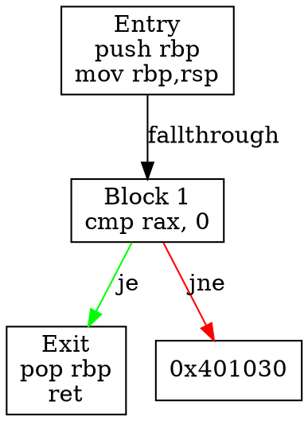

# FORTRESS Phase 3 — Advanced Static Analysis Engine Plan

**Project**: FORTRESS  
**Phase**: 3 — Advanced Static Analysis Engine  
**Prerequisite**: Phase 2 Binary Analyzer Core (must be complete and validated)  
**Status**: Milestone 1 Complete, Milestone 2+ Planned  

---

## Objective

Transform the binary analysis results from Phase 2 into deep, actionable static analysis structures:

- **Control Flow Graphs (CFG)** per function
- **Call Graph** with direct/indirect call resolution
- **Cross-Reference (XREF) Database** for navigation
- **Function Refinement** with confidence scoring
- **String Analysis** with encoding detection
- **Metrics & Coverage** reporting
- **JSON Serialization** for all analysis artifacts

---

## Milestone Status

| Milestone | Focus | Status | Target |
|-----------|-------|--------|--------|
| **M1: Analysis Data Model** | Unified normalized representation, typed addresses, format-specific converters, round-trip normalization | ✅ **Complete** | Week 1 |
| **M2: CFG Builder** | Basic blocks, edges, JSON output | 📋 Planned | Week 2-3 |
| **M3: Call Graph** | Nodes, edges, resolution, DOT export | 📋 Planned | Week 3-4 |
| **M4: XREF Database** | In-memory + SQLite, query API | 📋 Planned | Week 4-5 |
| **M5: Function Refiner** | Boundary refinement, confidence scoring | 📋 Planned | Week 5-6 |
| **M6: String Analyzer** | Encoding detection, classification | 📋 Planned | Week 6-7 |
| **M7: Metrics & Reporting** | JSON schema, GraphViz export | 📋 Planned | Week 7-8 |
| **M8: CLI Integration** | New commands, help, tests | 📋 Planned | Week 8-9 |

---

## Milestone 1: Analysis Data Model — ✅ Complete

### Delivered Components

| Component | Description | Status |
|-----------|-------------|--------|
| **TypedAddress** | Strongly-typed address wrapper with `AddressSpace` (FileOffset, RVA, VA, SegmentVA) | ✅ |
| **PEAddressConverter** | FileOffset ↔ RVA ↔ VA with overflow checks, ambiguous conversion detection | ✅ |
| **ELFAddressConverter** | FileOffset ↔ VA with p_filesz/p_memsz distinction, ambiguous conversion detection | ✅ |
| **MachOAddressConverter** | FileOffset ↔ VA ↔ SegmentVA with segment index encoding, round-trip support | ✅ |
| **NormalizedAnalysisResult** | Unified representation: sections, symbols, imports, exports, relocations, functions | ✅ |
| **BinaryMetadata** | Format-specific metadata preservation (PE/ELF/Mach-O specific fields) | ✅ |
| **Normalization** | `normalize_analysis_result()` / `denormalize_analysis_result()` round-trip | ✅ |
| **JSON Serialization** | Safe escaping for quotes, backslashes, control chars, Unicode | ✅ |
| **Overflow Protection** | Checked arithmetic in all address conversions | ✅ |

### Validation

| Test Suite | Tests | Status |
|------------|-------|--------|
| AnalysisModel | 72 | ✅ 72/72 passing |
| BinaryAnalyzer | 7 | ✅ 7/7 passing |
| PEParser | 4 | ✅ 4/4 passing |
| ELFParser | 6 | ✅ 6/6 passing |
| MachOParser | 7 | ✅ 7/7 passing |
| CoreHash | 12 | ✅ 12/12 passing |
| CoreTypes/Error/String/File | 15 | ✅ 15/15 passing |
| **Total** | **123/123** | **100% passing** |

**All tests passing in Debug configuration.**

### Files Added/Modified

| File | Change |
|------|--------|
| `include/fortress/binary/analysis/analysis_model.h` | New: TypedAddress, NormalizedAnalysisResult, BinaryMetadata, converters |
| `src/binary/analysis/analysis_model.cpp` | New: normalization/denormalization, JSON escaping |
| `include/fortress/binary/formats/pe/pe_address_converter.h` | Hardened: overflow checks, ambiguous conversion detection |
| `include/fortress/binary/formats/elf/elf_address_converter.h` | Hardened: p_filesz/p_memsz distinction, ambiguous detection |
| `include/fortress/binary/formats/macho/macho_address_converter.h` | New: SegmentVA round-trip with segment index encoding |
| `tests/unit/test_analysis_model.cpp` | 38 new regression tests |

---

## Milestone 2+: Advanced Static Analysis (Planned)

The remaining milestones (CFG Builder, Call Graph, XREF Database, Function Refiner, String Analyzer, Metrics & Reporting, CLI Integration) remain planned for subsequent phases. See the original plan below for detailed specifications.

---

## Original Phase 3 Plan (Milestones 2-8)

### 1. CFG Builder (`src/analysis/cfg/`)

**Input**: `FunctionInfo` + decoded instructions from Phase 2  
**Output**: `ControlFlowGraph` per function

#### Data Structures

```cpp
struct BasicBlock {
    Offset start_offset;
    Address start_address;
    Size size;
    std::vector<InstructionInfo> instructions;
    std::vector<Edge> successors;      // Outgoing edges
    std::vector<Edge> predecessors;    // Incoming edges
    BlockType type;                    // Entry, Exit, Normal, LoopHeader, etc.
};

struct Edge {
    Offset target_offset;
    EdgeType type;                     // Conditional, Unconditional, Call, Return, Fallthrough
    bool is_resolved;                  // Target address known
    Address target_address;            // If resolved
};

struct ControlFlowGraph {
    FunctionInfo function;
    std::vector<BasicBlock> blocks;
    Offset entry_block;
    std::vector<Offset> exit_blocks;
    std::vector<LoopInfo> loops;       // Natural loops
    DominatorTree dominators;          // Optional
};
```

#### Algorithms

1. **Leader Identification**
   - Function entry point
   - Targets of all jumps/calls
   - Instructions following jumps/calls/returns
   - Exception handler entries

2. **Block Construction**
   - Linear scan from each leader to next leader
   - Instruction decoding per block
   - Edge classification (conditional/unconditional/call/return/fallthrough)

3. **Edge Resolution**
   - Direct jumps: resolve target address
   - Indirect jumps: mark unresolved, record operand
   - Calls: separate call edges from CFG edges
   - Returns: mark as exit edges

4. **Analysis** (Optional, Phase 3.5+)
   - Dominator tree construction
   - Natural loop detection (Havlak's algorithm)
   - Reducibility check
   - SCC decomposition

#### Output Format

```json
{
  "function": { ... },
  "blocks": [
    {
      "id": 0,
      "start_address": "0x401000",
      "size": 32,
      "instructions": [...],
      "successors": [
        {"target": 1, "type": "conditional", "resolved": true},
        {"target": 2, "type": "fallthrough", "resolved": true}
      ]
    }
  ],
  "entry_block": 0,
  "exit_blocks": [5, 8],
  "loops": [...]
}
```

---

### 2. Call Graph (`src/analysis/callgraph/`)

**Input**: All `FunctionInfo` + instruction operands + relocations  
**Output**: `CallGraph` with nodes/edges

#### Data Structures

```cpp
struct CallNode {
    FunctionInfo function;
    std::vector<CallEdge> outgoing;    // Calls made by this function
    std::vector<CallEdge> incoming;    // Calls to this function
    CallType type;                     // Direct, Indirect, Tail, External
};

struct CallEdge {
    CallNode* caller;
    CallNode* callee;                  // Null if unresolved
    Offset call_site;                  // Instruction offset
    CallKind kind;                     // Direct, Indirect, Tail, Syscall
    ConfidenceLevel confidence;
    bool is_external;                  // Library/System call
};
```

#### Edge Classification

| Kind | Description | Resolution |
|------|-------------|------------|
| Direct | `call 0x401000` | Symbol table / address |
| Indirect | `call rax` | Data flow analysis (Phase 3.5+) |
| Tail | `jmp 0x401000` at end | Heuristic + CFG |
| External | `call ds:__imp_*` | Import table |
| Syscall | `syscall` / `int 0x80` | Special handling |

#### Resolution Strategy

1. **Direct Calls**: Resolve via symbol table, export table, or direct address
2. **Import Thunks**: Match via import table (PE) / GOT/PLT (ELF) / stubs (Mach-O)
3. **Indirect Calls**: Mark unresolved, record operand register/memory
4. **Tail Calls**: Detect via CFG (call at block end followed by return)
5. **Virtual Calls**: C++ vtable analysis (Phase 3.5+)

#### Output

```json
{
  "nodes": [
    {
      "function": { ... },
      "outgoing": [
        {"callee": "0x402000", "kind": "direct", "site": "0x401050", "confidence": "confirmed"},
        {"callee": null, "kind": "indirect", "site": "0x401080", "confidence": "low", "operand": "rax"}
      ]
    }
  ]
}
```

---

### 3. XREF Database (`src/analysis/xref/`)

**Input**: All instructions, relocations, symbols, data references  
**Output**: Queryable cross-reference database

#### Reference Types

| Type | Source | Target | Example |
|------|--------|--------|---------|
| Code→Code | Instruction | Function/Block | `call`, `jmp`, `jcc` |
| Code→Data | Instruction | Variable/String | `mov rax, [addr]`, `lea rax, [str]` |
| Data→Code | Pointer/Table | Function | vtable, jump table, exception handler |
| Data→Data | Pointer/Table | Variable/String | Global pointer, string table |
| Relocation | Reloc Entry | Symbol/Section | `R_X86_64_RELATIVE` |

#### Data Model

```cpp
struct CrossReference {
    Address from_address;      // Source location
    Address to_address;        // Target location
    XRefType type;             // Code→Code, Code→Data, etc.
    XRefKind kind;             // Read, Write, Execute, Offset
    Offset instruction_offset; // If from instruction
    std::string context;       // Instruction mnemonic, etc.
    ConfidenceLevel confidence;
};
```

#### Storage

- **In-memory**: `std::unordered_multimap<Address, CrossReference>`
- **Persistent**: SQLite database (`xrefs.db`) with indices on `from_address`, `to_address`, `type`
- **Query API**:
  - `get_xrefs_to(address)` - Who references this?
  - `get_xrefs_from(address)` - What does this reference?
  - `get_xrefs_between(from, to)` - Direct connections

---

### 4. Function Refiner (`src/analysis/functions/`)

**Input**: Raw `FunctionInfo` from Phase 2 + CFG + Call Graph  
**Output**: Refined `FunctionInfo` with higher confidence

#### Refinement Pipeline

1. **Boundary Refinement**
   - Use CFG to detect actual function end (last return/unreachable)
   - Detect tail-call merged functions
   - Split incorrectly merged functions (heuristic: multiple entry points)

2. **Confidence Scoring**
   ```
   Confidence = Base + SymbolBonus + CFGBonus + CallGraphBonus + HeuristicPenalty
   
   Base: 50 (heuristic only)
   SymbolBonus: +50 if exported symbol, +30 if local symbol
   CFGBonus: +20 if clean CFG (single entry, proper exits)
   CallGraphBonus: +15 if called from confirmed function
   HeuristicPenalty: -20 if prologue mismatch, -30 if overlapping
   ```

3. **Prologue/Epilogue Detection**
   - x86: `push rbp; mov rbp, rsp` / `push ebp; mov ebp, esp`
   - x64: Shadow space allocation, register saves
   - ARM64: `stp x29, x30, [sp, #-16]!; mov x29, sp`
   - Detect non-standard (optimized, hand-written asm)

4. **Exception Handling**
   - Identify SEH (PE) / DWARF (ELF) / compact unwind (Mach-O)
   - Mark functions with handlers

#### Output

Enhanced `FunctionInfo` with:
- Refined boundaries (start, end)
- Confidence level
- Prologue/epilogue signatures
- Exception handler info
- Inline candidate flag

---

### 5. String Analyzer (`src/analysis/strings/`)

**Input**: All sections with readable data  
**Output**: String catalog with encoding, references, classification

#### Detection

| Encoding | Detection | Validation |
|----------|-----------|------------|
| ASCII | High-bit clear, printable | All chars 0x20-0x7E |
| UTF-8 | Valid UTF-8 sequences | RFC 3629 compliance |
| UTF-16LE | Null every 2nd byte | Even-length, valid surrogates |
| UTF-16BE | Null every 1st byte | Even-length, valid surrogates |
| Wide (wchar_t) | Platform-dependent | Context-dependent |

#### String Info

```cpp
struct StringInfo {
    Address address;
    Size length;
    Encoding encoding;
    std::string content;           // Decoded to UTF-8
    std::string raw_hex;           // Original bytes
    SectionInfo section;
    std::vector<CrossReference> xrefs;  // Code references to this string
    StringType type;               // ASCII, Unicode, Resource, Error msg, URL, Path, etc.
    float entropy;
    bool is_obfuscated;            // XOR, ROT, encryption detected
};
```

#### Classification

| Type | Heuristics |
|------|------------|
| Error Message | Contains "error", "fail", "invalid", "%s", "%d" |
| URL | Starts with http://, https://, ftp:// |
| File Path | Contains /, \, :, drive letters |
| Registry | Contains HKEY_, \Registry\, \System\ |
| Crypto Constant | High entropy, fixed length (16, 32, 64) |
| Format String | Contains %s, %d, %x, %p |
| Debug/Log | Contains "debug", "trace", "log", "[INFO]" |

---

### 6. Metrics Engine (`src/analysis/metrics/`)

**Input**: All analysis artifacts  
**Output**: Quantitative metrics report

#### Metric Categories

| Category | Metrics |
|----------|---------|
| **Coverage** | % functions analyzed, % instructions decoded, % sections covered |
| **Complexity** | Cyclomatic complexity per function, nesting depth, basic block count |
| **Call Graph** | Fan-in/out, recursion depth, SCC count, unreachable functions |
| **CFG** | Blocks per function, edge density, loop nesting, reducibility |
| **XREF** | Reference density, orphan code/data, unresolved indirect calls |
| **Strings** | Count by encoding, type, entropy distribution |
| **Functions** | Count by confidence, size distribution, inline candidates |

#### Output

```json
{
  "summary": {
    "total_functions": 1250,
    "confirmed": 890,
    "heuristic": 360,
    "coverage_percent": 92.5
  },
  "complexity": {
    "avg_cyclomatic": 4.2,
    "max_cyclomatic": 47,
    "functions_over_10": 23
  },
  "call_graph": {
    "nodes": 1250,
    "edges": 3420,
    "scc_count": 15,
    "max_fan_out": 42
  },
  "strings": {
    "total": 5420,
    "ascii": 3100,
    "utf8": 1200,
    "utf16": 420,
    "obfuscated": 15
  }
}
```

---

### 7. Report Serializer (`src/analysis/report/`)

**Input**: All analysis artifacts  
**Output**: JSON report (Schema v1.0), optional GraphViz DOT

#### Schema Versioning

```json
{
  "schema_version": "1.0",
  "tool": {
    "name": "FORTRESS",
    "version": "0.2.0",
    "build_date": "2025-11-07"
  },
  "binary": { ... },
  "analysis": {
    "functions": [...],
    "cfg": { ... },
    "call_graph": { ... },
    "xrefs": { ... },
    "strings": [...],
    "metrics": { ... }
  },
  "warnings": [...],
  "errors": [...]
}
```

#### GraphViz Export



---

## CLI Integration

### New Commands

```bash
# CFG generation
fortress cfg -i binary.exe -f function_name -o cfg.json
fortress cfg -i binary.exe --all -o cfg_all.json

# Call graph
fortress callgraph -i binary.exe -o callgraph.json
fortress callgraph -i binary.exe --dot -o callgraph.dot

# XREF queries
fortress xref -i binary.exe --to 0x401000
fortress xref -i binary.exe --from 0x402000 --type code

# String analysis
fortress strings -i binary.exe --encoding utf8 --type url -o strings.json

# Full analysis report
fortress analyze -i binary.exe --full -o full_report.json
fortress analyze -i binary.exe --full --dot -o report/
```

---

## Testing Strategy

### Unit Tests per Module

| Module | Test Cases |
|--------|------------|
| CFG Builder | Single block, conditional, loop, switch, exception, indirect jump |
| Call Graph | Direct, indirect, tail, external, recursive, mutual recursion |
| XREF | Code→Code, Code→Data, Data→Code, Data→Data, unresolved |
| Function Refiner | Boundary merge/split, prologue detection, confidence scoring |
| String Analyzer | ASCII, UTF-8, UTF-16, obfuscated, classification |
| Metrics | Empty, single function, recursive, large binary |

### Fixtures

```
tests/fixtures/
├── cfg/
│   ├── simple_function.bin
│   ├── conditional_branch.bin
│   ├── loop_while.bin
│   ├── switch_jump_table.bin
│   └── exception_handling.bin
├── callgraph/
│   ├── direct_calls.bin
│   ├── indirect_calls.bin
│   ├── tail_calls.bin
│   └── mutual_recursion.bin
├── xref/
│   ├── code_to_code.bin
│   ├── code_to_data.bin
│   └── data_to_code.bin
└── strings/
    ├── ascii_strings.bin
    ├── utf8_strings.bin
    ├── utf16_strings.bin
    └── obfuscated_strings.bin
```

### Property-Based Testing

- Random binary generation for fuzzing parsers
- CFG invariants: all blocks reachable from entry, no dangling edges
- Call graph: no self-loops without recursion, SCC properties
- XREF symmetry: if A references B, B has reverse reference

---

## Performance Targets

| Operation | Target (1MB binary) | Target (10MB binary) |
|----------|---------------------|----------------------|
| CFG Construction | < 500ms | < 5s |
| Call Graph Construction | < 300ms | < 3s |
| XREF Database Build | < 200ms | < 2s |
| String Analysis | < 100ms | < 1s |
| Full Report Generation | < 1s | < 10s |
| Memory Usage | < 200MB | < 1GB |

---

## Dependencies

### Required (Already in Phase 2)

- LLVM 18+ (MC, MCDisassembler for instruction decoding)
- nlohmann_json (JSON serialization)
- GoogleTest (testing)

### New for Phase 3

| Library | Purpose | License |
|---------|---------|---------|
| SQLite3 | XREF persistent storage | Public Domain |
| GraphViz (libgvc) | DOT export (optional) | EPL |
| Capstone (optional) | Alternative disassembler | BSD |

---

## Timeline

| Milestone | Target | Deliverable |
|-----------|--------|-------------|
| M1: CFG Builder | Week 1-2 | Basic blocks, edges, JSON output |
| M2: Call Graph | Week 2-3 | Nodes, edges, resolution, DOT export |
| M3: XREF Database | Week 3-4 | In-memory + SQLite, query API |
| M4: Function Refiner | Week 4-5 | Boundary refinement, confidence |
| M5: String Analyzer | Week 5-6 | Encoding detection, classification |
| M6: Metrics & Reporting | Week 6-7 | JSON schema, GraphViz export |
| M7: CLI Integration | Week 7-8 | New commands, help, tests |
| M8: Validation & Polish | Week 8-9 | Benchmarks, docs, edge cases |

---

## Integration Points

### Phase 2 → Phase 3 Data Flow

```
Phase 2 BinaryAnalyzer
       │
       ▼
┌────────────────────────────────────┐
│ BinaryAnalysisResult               │
│ - functions: vector<FunctionInfo>  │
│ - sections: vector<SectionInfo>    │
│ - symbols: vector<SymbolInfo>      │
│ - imports/exports                  │
│ - relocations                      │
│ - (optional) disassembly           │
└────────────────────────────────────┘
       │
       ▼
┌────────────────────────────────────┐
│ Phase 3 AnalysisContext            │
│ - cfg_builder: CFGBuilder          │
│ - call_graph: CallGraphBuilder     │
│ - xref_db: XRefDatabase            │
│ - func_refiner: FunctionRefiner    │
│ - string_analyzer: StringAnalyzer  │
│ - metrics: MetricsEngine           │
│ - serializer: ReportSerializer     │
└────────────────────────────────────┘
       │
       ▼
┌────────────────────────────────────┐
│ AnalysisReport (JSON/Schema v1.0)  │
└────────────────────────────────────┘
```

---

## Risk Mitigation

| Risk | Likelihood | Impact | Mitigation |
|------|------------|--------|------------|
| Indirect call resolution incomplete | High | Medium | Mark unresolved, defer to Phase 3.5+ |
| CFG irreducibility (obfuscation) | Medium | High | Detect, flag, fall back to region-based |
| XREF database size explosion | Low | High | Streaming write, SQLite paging |
| Disassembly errors cascade | Medium | High | Validate at each stage, mark uncertain |
| Performance on large binaries | Medium | Medium | Streaming, parallelization, sampling |

---

## Success Criteria

- [ ] All modules compile and pass unit tests
- [ ] Integration tests pass on test fixtures
- [ ] `fortress analyze --full` produces valid JSON Schema v1.0
- [ ] `fortress cfg/callgraph/xref/strings` commands functional
- [ ] Performance targets met on 1MB/10MB benchmarks
- [ ] Documentation complete (CLI.md, ARCHITECTURE.md updated)
- [ ] Phase 3 docs in `docs/PHASE3_PROGRESS.md`